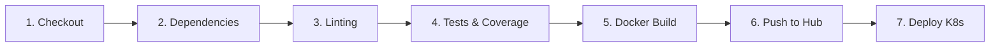

# DevOps Implementation & Run Guide
## Smart Canteen Ordering System (ABL 1)

This comprehensive guide walks through local execution, containerization with Docker, CI/CD automation via Jenkins, Kubernetes deployment on Minikube / Docker Desktop, and free-tier Cloud deployment (Render / Railway).

---

## 1. Running Locally (Development Mode)

### 1.1 Prerequisites
- Python 3.11 or 3.12 installed
- PowerShell / Command Prompt / Terminal

### 1.2 Step-by-Step Setup Commands
```powershell
# 1. Navigate to the project root directory
cd c:\Users\ammu\OneDrive\Desktop\spmabl

# 2. Create and activate a Python virtual environment
python -m venv venv
.\venv\Scripts\Activate.ps1   # On Linux/macOS: source venv/bin/activate

# 3. Install dependencies
python -m pip install --upgrade pip
python -m pip install -r requirements.txt

# 4. Seed the database with sample menu items and users
python seed.py
```

**Expected Seeder Output**:
```plaintext
[*] Dropping and recreating all database tables...
[*] Seeding pickup slot configurations...
[*] Seeding system users...
[*] Seeding categories and menu items...
[*] Seeding initial demo orders...

[+] Database seeding complete!
-------------------------------------------------------
Demo Credentials:
  Admin:   admin     / Admin@123
  Staff:   staff     / Staff@123
  Student: student1  / Student@123  (Wallet: Rs 500)
  Student: student2  / Student@123  (Wallet: Rs 350)
-------------------------------------------------------
```

### 1.3 Start the Local Development Server
```powershell
# Start server with Waitress on Windows (or python wsgi.py)
python wsgi.py
```
Open your browser and navigate to: `http://localhost:5000`

### 1.4 Run Automated Linting & Tests
```powershell
# 1. Run Flake8 Code Style Check
python -m flake8 app tests --max-line-length=120

# 2. Run Pytest with Test Coverage
python -m pytest tests/ -v --cov=app --cov-report=term-missing --cov-fail-under=80
```
**Expected Test Output**:
```plaintext
============================= 27 passed in 6.06s ==============================
Required test coverage of 80% reached. Total coverage: 85.22%
```

---

## 2. Docker Containerization

### 2.1 Multi-Stage Build & Tagging
Build the container image with version and build number tags:
```powershell
# Tag format: smart-canteen:1.0.<BUILD_NUMBER>
docker build -t smart-canteen:1.0.1 -t smart-canteen:latest .
```

### 2.2 Run Containerized Application
```powershell
docker run -d \
  --name smart-canteen-app \
  -p 5000:5000 \
  -e FLASK_ENV=production \
  -e SECRET_KEY=my-docker-secret-key \
  smart-canteen:1.0.1
```

### 2.3 Verify Container Health & Logs
```powershell
# Inspect running container
docker ps

# Check container health status (handled by HEALTHCHECK directive)
docker inspect --format='{{json .State.Health}}' smart-canteen-app

# Inspect application logs
docker logs -f smart-canteen-app
```
Test health endpoint directly:
```powershell
curl http://localhost:5000/health
```
**Expected Response**:
```json
{
  "status": "healthy",
  "service": "smart-canteen-ordering-system",
  "database": "connected",
  "timestamp": "2026-11-17T10:30:00.000000Z"
}
```

---

## 3. Jenkins CI/CD Pipeline Automation

### 3.1 Pipeline Architecture
The declarative `Jenkinsfile` automates 7 sequential stages:


### 3.2 Jenkins Setup Instructions
1. Open Jenkins Dashboard (`http://localhost:8080`).
2. Go to **Manage Jenkins** $\rightarrow$ **Credentials** $\rightarrow$ **System** $\rightarrow$ **Global credentials**:
   - Add **Username with password** credential:
     - ID: `docker-hub-credentials`
     - Username: Your Docker Hub username
     - Password: Your Docker Hub Access Token
   - Add **Secret file** credential:
     - ID: `k8s-kubeconfig`
     - File: Your `~/.kube/config` (or Minikube kubeconfig)
3. Create a **New Item** $\rightarrow$ Select **Pipeline** $\rightarrow$ Name: `smart-canteen-pipeline`.
4. In the Pipeline section, select **Pipeline script from SCM**:
   - SCM: **Git**
   - Repository URL: `<YOUR_GITHUB_REPO_URL>`
   - Script Path: `Jenkinsfile`
5. Click **Build with Parameters** $\rightarrow$ Click **Build**.

### 3.3 Post-Build Artifacts
Upon pipeline completion, Jenkins automatically archives:
- JUnit Test Results (`reports/junit.xml`)
- Interactive HTML Code Coverage Reports (`reports/coverage_html/index.html`)

---

## 4. Kubernetes (K8s) Orchestration

### 4.1 Prerequisites
- Minikube, Docker Desktop Kubernetes, or MicroK8s installed and running.
- `kubectl` CLI configured.

### 4.2 Step-by-Step Cluster Deployment
```bash
# 1. Create dedicated namespace
kubectl apply -f k8s/namespace.yaml

# 2. Deploy ConfigMap and Secret
kubectl apply -f k8s/configmap.yaml
kubectl apply -f k8s/secret.yaml

# 3. Deploy the application pods (2 replicas with rolling updates)
kubectl apply -f k8s/deployment.yaml

# 4. Deploy the NodePort service
kubectl apply -f k8s/service.yaml

# 5. (Optional) Deploy Ingress
kubectl apply -f k8s/ingress.yaml
```

### 4.3 Verifying Deployment Status
```bash
# Verify namespace resources
kubectl get all -n smart-canteen

# Verify rolling rollout status
kubectl rollout status deployment/smart-canteen-deployment -n smart-canteen

# Check pod logs
kubectl logs -n smart-canteen -l app=smart-canteen --tail=50
```

**Expected `kubectl get pods,svc -n smart-canteen` Output**:
```plaintext
NAME                                            READY   STATUS    RESTARTS   AGE
pod/smart-canteen-deployment-6d4b9f69b8-4m2q9   1/1     Running   0          45s
pod/smart-canteen-deployment-6d4b9f69b8-z7k8l   1/1     Running   0          45s

NAME                            TYPE       CLUSTER-IP      EXTERNAL-IP   PORT(S)          AGE
service/smart-canteen-service   NodePort   10.108.140.22   <none>        5000:30080/TCP   45s
```

### 4.4 Accessing the Application
- **Minikube NodePort Access**:
  ```bash
  minikube service smart-canteen-service -n smart-canteen --url
  ```
  Or directly browse to: `http://<MINIKUBE_IP>:30080`
- **Docker Desktop Kubernetes**:
  Open: `http://localhost:30080`

---

## 5. Free-Tier Cloud Deployment (Fallback Option)

If Kubernetes is unavailable during your project evaluation, you can deploy the Docker container to a free-tier cloud platform in under 3 minutes.

### Option A: Render.com (Recommended)
1. Push this repository to GitHub.
2. In [Render.com](https://render.com), select **New +** $\rightarrow$ **Blueprint** and connect the repository.
3. Render reads `render.yaml` and creates the Python web service. It installs `requirements.txt`, runs Gunicorn on Render's assigned `$PORT`, and checks `/health`.
4. The Blueprint generates a production `SECRET_KEY`; do not set `PORT` manually.
5. After the first deploy, initialize the empty database from the service Shell with `python seed.py` if demo accounts and menu items are needed. **This script drops and recreates all tables**, so only run it against a new/empty database.

The default SQLite database is ephemeral on Render and can be lost when the service restarts or redeploys. For persistent production data, create a Render PostgreSQL database and set the web service's `DATABASE_URL` to its **internal** connection URL. The app creates its tables at startup and supports Render's `postgres://` URL format. Back up or migrate any existing data before switching databases.

To deploy the Docker image instead, create a Render Web Service using the Docker runtime and the repository's `Dockerfile`; it also binds to the dynamically assigned `PORT`.

### Option B: Railway.app
1. Navigate to [Railway.app](https://railway.app) and click **New Project** $\rightarrow$ **Deploy from GitHub repo**.
2. Select the repository. Railway will detect the `Dockerfile` automatically.
3. In **Variables**, set:
   - `PORT`: `5000`
   - `SECRET_KEY`: `random-production-key-here`
4. In **Settings**, click **Generate Domain**. Your container will be live with full SSL in 60 seconds.
