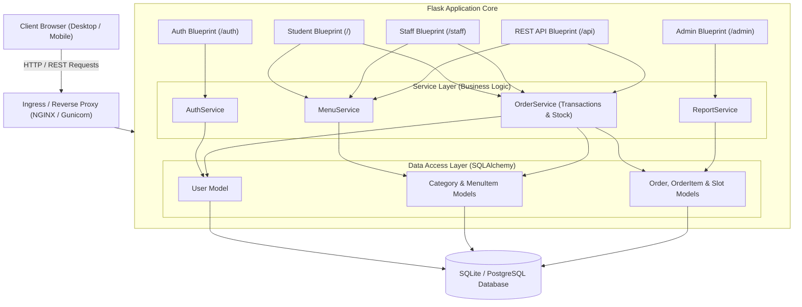

# Software Design Specification (SDS)
## Smart Canteen Ordering System (ABL 1)

---

## 1. System Architecture

The application adopts a **Modular Layered Architecture (Flask Application Factory with Blueprints)**:



---

## 2. Database Schema & Data Dictionary

### 2.1 Table: `users`
| Column | Type | Constraints | Description |
| :--- | :--- | :--- | :--- |
| `id` | Integer | PK, Auto Increment | Unique user identifier |
| `username` | String(80) | Unique, Not Null, Index | Unique campus login username |
| `email` | String(120) | Unique, Not Null, Index | College email address |
| `password_hash` | String(255) | Not Null | PBKDF2/SHA-256 hashed password |
| `role` | String(20) | Not Null | Role: `student`, `staff`, `admin` |
| `wallet_balance` | Float | Not Null, Default 500.0 | Available mock balance for canteen purchases |
| `created_at` | DateTime | Not Null | Account creation timestamp |

### 2.2 Table: `categories`
| Column | Type | Constraints | Description |
| :--- | :--- | :--- | :--- |
| `id` | Integer | PK, Auto Increment | Unique category ID |
| `name` | String(50) | Unique, Not Null | Category name (e.g., South Indian, Beverages) |
| `description` | String(255) | Nullable | Category summary description |

### 2.3 Table: `menu_items`
| Column | Type | Constraints | Description |
| :--- | :--- | :--- | :--- |
| `id` | Integer | PK, Auto Increment | Unique food item ID |
| `category_id` | Integer | FK (`categories.id`), Not Null | Category foreign key |
| `name` | String(100) | Not Null, Index | Item name |
| `description` | Text | Nullable | Detailed food description |
| `price` | Float | Not Null | Price in INR |
| `stock` | Integer | Not Null, Default 0 | Current remaining portion inventory |
| `is_available`| Boolean | Not Null, Default True | Manual/auto availability flag |
| `prep_time_minutes`| Integer | Not Null, Default 10 | Standard preparation time |
| `created_at` | DateTime | Not Null | Timestamp item was registered |

### 2.4 Table: `orders`
| Column | Type | Constraints | Description |
| :--- | :--- | :--- | :--- |
| `id` | Integer | PK, Auto Increment | Unique Order ID |
| `user_id` | Integer | FK (`users.id`), Not Null | Student owner foreign key |
| `status` | String(30) | Not Null, Default 'Placed' | `Placed`, `Accepted`, `Preparing`, `Ready`, `Collected`, `Cancelled` |
| `pickup_slot` | String(50) | Not Null, Index | Scheduled pickup time window |
| `payment_method` | String(30) | Not Null | `Wallet`, `UPI`, `Cash on Pickup` |
| `payment_status` | String(30) | Not Null | `Paid`, `Pending`, `Refunded` |
| `total_amount` | Float | Not Null | Final order cost in INR |
| `estimated_wait_minutes` | Integer | Not Null | Dynamic wait time based on queue |
| `idempotency_key` | String(100) | Unique, Nullable | Duplicate submission prevention key |
| `created_at` | DateTime | Not Null, Index | Order placement timestamp |
| `updated_at` | DateTime | Not Null | Last status update timestamp |

### 2.5 Table: `order_items`
| Column | Type | Constraints | Description |
| :--- | :--- | :--- | :--- |
| `id` | Integer | PK, Auto Increment | Unique order item ID |
| `order_id` | Integer | FK (`orders.id`), Not Null | Parent order foreign key |
| `menu_item_id` | Integer | FK (`menu_items.id`), Not Null | Ordered menu item foreign key |
| `quantity` | Integer | Not Null, Default 1 | Number of portions ordered |
| `unit_price` | Float | Not Null | Price per unit at purchase time |
| `subtotal` | Float | Not Null | `unit_price * quantity` |

### 2.6 Table: `pickup_slot_configs`
| Column | Type | Constraints | Description |
| :--- | :--- | :--- | :--- |
| `id` | Integer | PK, Auto Increment | Unique slot configuration ID |
| `slot_time` | String(50) | Unique, Not Null | Slot label (e.g. `12:00 PM - 12:30 PM`) |
| `max_orders`| Integer | Not Null, Default 10 | Maximum simultaneous orders allowed |
| `is_active` | Boolean | Not Null, Default True | Whether slot is available for booking |

---

## 3. REST API Endpoint Catalog

| Method | Endpoint | Auth Required | Description | Status Codes |
| :--- | :--- | :--- | :--- | :--- |
| `GET` | `/health` | Public | Liveness & readiness probe | `200 OK`, `503 Degraded` |
| `GET` | `/api/health` | Public | JSON health metrics | `200 OK`, `503 Degraded` |
| `GET` | `/api/menu` | Public | Retrieve all items with filter `?category_id=&q=&available_only=` | `200 OK` |
| `GET` | `/api/slots` | Public | Retrieve active pickup slots and capacities | `200 OK` |
| `POST`| `/api/orders` | Student | Place order via JSON payload | `201 Created`, `400 Bad Request`, `409 Conflict` |
| `GET` | `/api/orders/<id>/status`| Authenticated | Poll live order status, queue pos & wait time | `200 OK`, `403 Forbidden`, `404 Not Found` |
| `POST`| `/api/orders/<id>/cancel`| Student | Cancel order (allowed when Placed/Accepted) | `200 OK`, `400 Disallowed`, `403 Forbidden` |
| `POST`| `/api/staff/orders/<id>/status`| Staff, Admin | Advance order lifecycle state | `200 OK`, `400 Bad Request` |
| `GET` | `/api/admin/sales` | Admin | Retrieve sales metrics and top selling dishes | `200 OK`, `403 Forbidden` |

### Sample JSON: POST `/api/orders`
```json
{
  "pickup_slot": "12:00 PM - 12:30 PM",
  "payment_method": "Wallet",
  "idempotency_key": "chk_1710688000_abcd123",
  "items": [
    { "item_id": 1, "quantity": 2 },
    { "item_id": 3, "quantity": 1 }
  ]
}
```

### Sample JSON: Response from `/api/orders/1/status`
```json
{
  "id": 1,
  "customer_name": "student1",
  "status": "Preparing",
  "pickup_slot": "12:00 PM - 12:30 PM",
  "payment_method": "Wallet",
  "payment_status": "Paid",
  "total_amount": 145.0,
  "queue_position": 2,
  "estimated_wait_minutes": 15,
  "items": [
    { "item_name": "Masala Dosa", "quantity": 2, "unit_price": 60.0, "subtotal": 120.0 },
    { "item_name": "Authentic Filter Coffee", "quantity": 1, "unit_price": 25.0, "subtotal": 25.0 }
  ]
}
```
