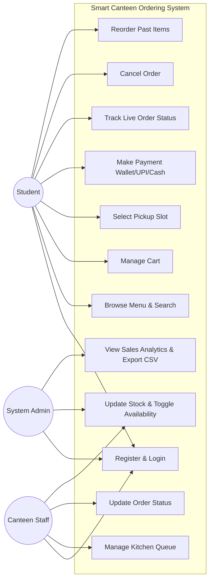
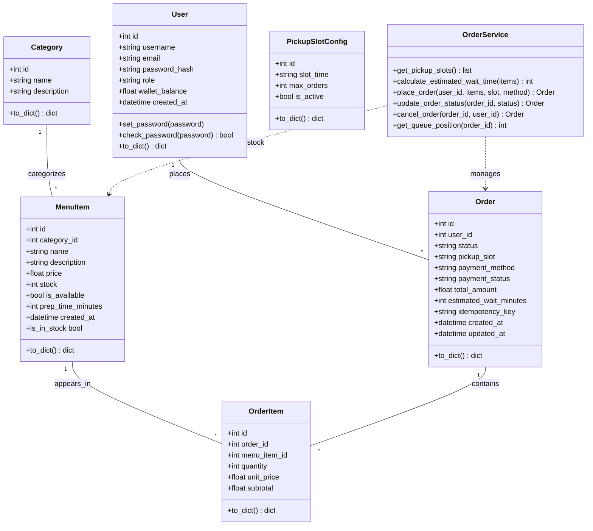
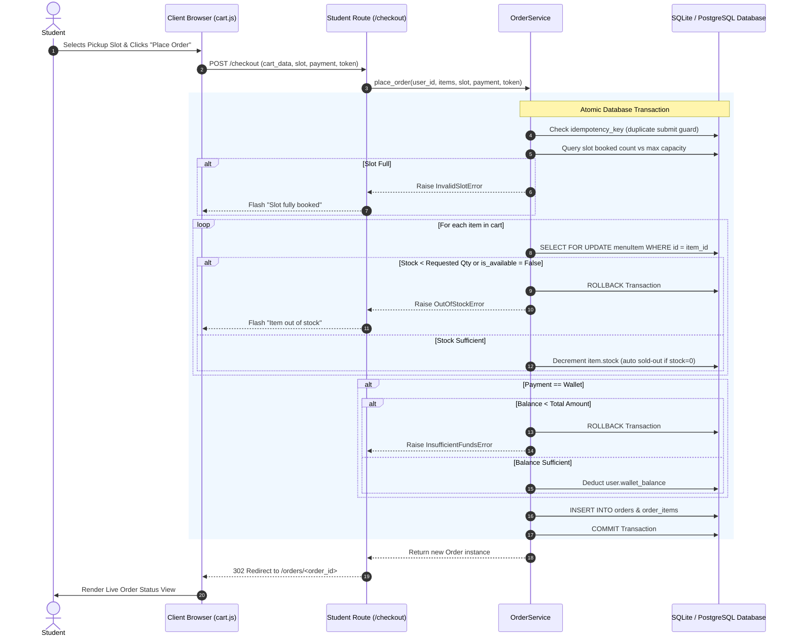
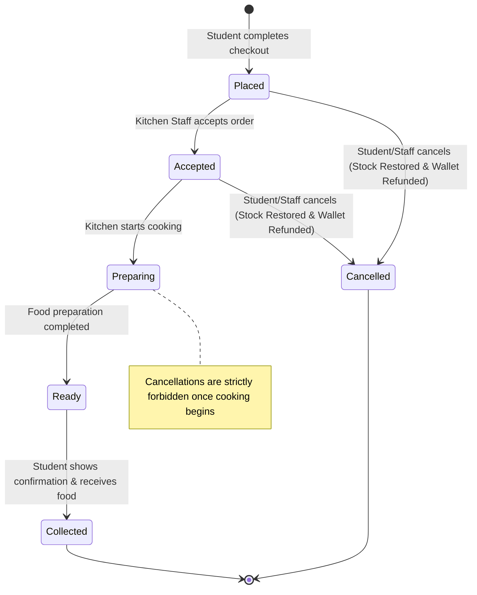
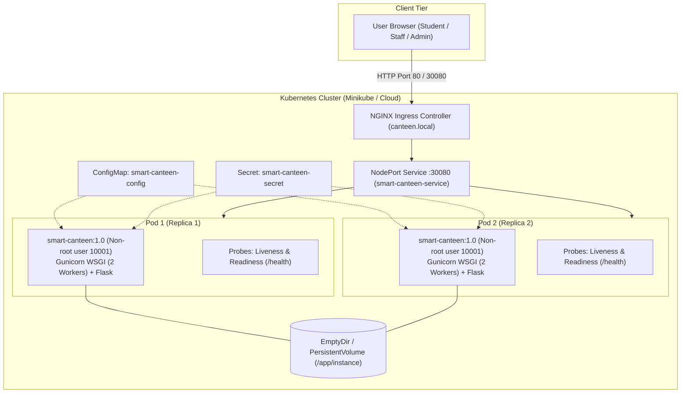

# UML Diagrams & System Models
## Smart Canteen Ordering System (ABL 1)

This document contains standard UML diagrams modeled in **Mermaid** and **PlantUML** format for viva presentations, architectural reviews, and project documentation.

---

## 1. Use Case Diagram

---

## 2. Class Diagram

---

## 3. Sequence Diagram: Place Order Flow

---

## 4. Activity Diagram: Order Lifecycle & Kitchen State Machine

---

## 5. Deployment Diagram (Kubernetes & Container Topology)

