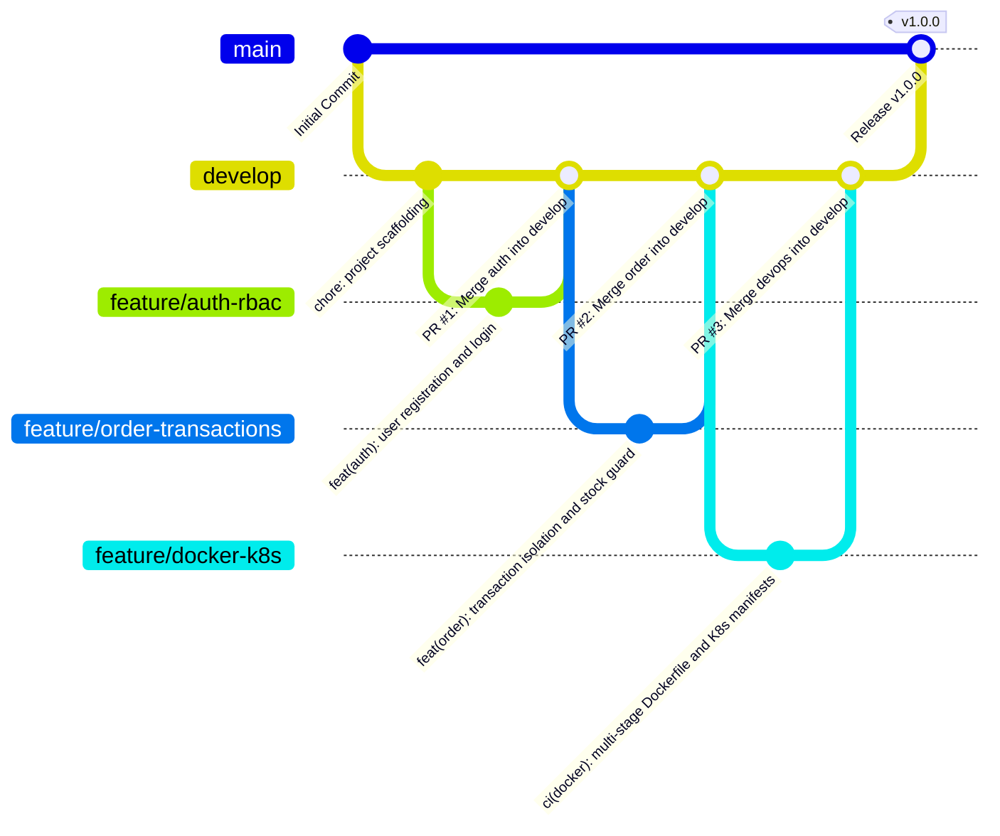

# GitHub Team Workflow & Git Simulation Guide

This document defines the team collaboration workflow, branching model, GitHub issues, pull request templates, and automated Jenkins SCM triggers for the **Smart Canteen Ordering System (ABL 1)**.

---

## 1. Team Structure & Member Roles (4 Students)

| Contributor | Role & Specialization | Primary Responsibilities | Feature Branches |
| :--- | :--- | :--- | :--- |
| **Member 1** | **DevOps & Infrastructure Lead** | Multi-stage Dockerfile, Kubernetes manifests (`k8s/`), declarative Jenkinsfile, cluster health probes | `feature/docker-k8s`, `feature/jenkins-ci-cd` |
| **Member 2** | **Backend & Security Engineer** | User authentication, password hashing, RBAC decorators (`@login_required`, `@roles_accepted`), Menu models & services | `feature/auth-rbac`, `feature/menu-management` |
| **Member 3** | **Core Logic & Transactions Engineer** | Order lifecycle state machine, transaction isolation, out-of-stock race condition prevention, slot capacity limits, payment & refund logic | `feature/order-transactions`, `feature/payments-and-slots`, `feature/admin-sales-report` |
| **Member 4** | **Frontend UI & QA Automation Engineer** | Responsive UI/UX, Vanilla JS Cart & 5s live status polling, Pytest test suite ($\ge 80\%$ coverage), API docs | `feature/responsive-ui`, `feature/automated-testing` |

---

## 2. Branching Strategy

We adhere to a streamlined **GitFlow / GitHub Flow** hybrid:



- **`main`**: Production-ready branch. Deployed to Kubernetes or Cloud via CI/CD.
- **`develop`**: Integration and staging branch. All feature branches merge here via Pull Request.
- **`feature/<name>`**: Dedicated short-lived branches created from `develop` for each user story or task.

---

## 3. GitHub Issues Ledger (10 Project Issues)

| Issue # | Type | Title | Assignee | Label | Milestone |
| :---: | :---: | :--- | :--- | :--- | :--- |
| **#1** | Task | Project Scaffolding & Application Factory | Member 1 | `infrastructure` | Milestone 1: Foundation |
| **#2** | Feature | User Authentication & RBAC (Student, Staff, Admin) | Member 2 | `security`, `backend` | Milestone 1: Foundation |
| **#3** | Feature | Food Menu Browsing, Search, and Category Filtering | Member 2 | `backend`, `frontend` | Milestone 2: Core Business |
| **#4** | Feature | Order Transaction Pipeline & Out-of-Stock Race Guard | Member 3 | `backend`, `critical` | Milestone 2: Core Business |
| **#5** | Feature | Pickup Slot Selection & Capacity Limiting | Member 3 | `backend` | Milestone 2: Core Business |
| **#6** | Feature | Mock Payment Handlers (Wallet, UPI, Cash) & Refunds | Member 3 | `backend` | Milestone 2: Core Business |
| **#7** | Feature | Client-Side Shopping Cart & Checkout UI | Member 4 | `frontend` | Milestone 3: UI & Tracking |
| **#8** | Feature | Live Order Status Stepper with 5s Polling | Member 4 | `frontend`, `api` | Milestone 3: UI & Tracking |
| **#9** | Feature | Staff Kitchen Dashboard & Stock Management | Member 2 | `staff`, `frontend` | Milestone 3: UI & Tracking |
| **#10**| Task | Declarative Jenkins CI/CD Pipeline & K8s Manifests | Member 1 | `devops`, `ci/cd` | Milestone 4: DevOps & Testing |

---

## 4. Pull Requests Simulation Matrix

| PR # | Title | Source Branch | Target Branch | Linked Issues | Author | Reviewer |
| :---: | :--- | :--- | :--- | :--- | :--- | :--- |
| **PR #1** | `feat(auth): implement user authentication and RBAC` | `feature/auth-rbac` | `develop` | Closes #2 | Member 2 | Member 1 |
| **PR #2** | `feat(menu): menu management and stock tracking` | `feature/menu-management` | `develop` | Closes #3, #9 | Member 2 | Member 4 |
| **PR #3** | `feat(order): transaction isolation and slot limits` | `feature/order-transactions` | `develop` | Closes #4, #5 | Member 3 | Member 2 |
| **PR #4** | `feat(payment): mock payments and cancellation refund` | `feature/payments-and-slots` | `develop` | Closes #6 | Member 3 | Member 1 |
| **PR #5** | `feat(ui): client cart and live 5s status polling` | `feature/live-polling-and-ui` | `develop` | Closes #7, #8 | Member 4 | Member 3 |
| **PR #6** | `ci(devops): Dockerfile, Jenkinsfile and Kubernetes manifests` | `feature/docker-k8s` | `develop` | Closes #1, #10 | Member 1 | Member 2 |
| **PR #7** | `release: merge develop into main for v1.0.0 deployment` | `develop` | `main` | - | Member 1 | All Members |

---

## 5. Automated Git Simulation Script

Once Git is installed on your local workstation, you can execute the following command sequence in PowerShell or Bash to generate the complete history and branches for the 4 team members:

```powershell
# ==============================================================
# Script: setup_git_history.ps1
# Simulates full 4-member collaborative Git repository
# ==============================================================

# 1. Initialize Git repository
git init
git branch -M main

# 2. Member 1 - Initial Commit on main
git config user.name "Member 1 (DevOps Lead)"
git config user.email "member1@college.edu"
git add .gitignore README.md
git commit -m "chore(init): initial repository setup and structure"

# 3. Create and switch to develop branch
git checkout -b develop

# 4. Member 2 - Feature: Authentication & RBAC
git checkout -b feature/auth-rbac
git config user.name "Member 2 (Backend & Security)"
git config user.email "member2@college.edu"
git add app/models/user.py app/services/auth_service.py app/routes/auth.py app/templates/auth/
git commit -m "feat(auth): implement password hashing, session login, and RBAC (#2)"
git checkout develop
git merge --no-ff feature/auth-rbac -m "Merge pull request #1 from feature/auth-rbac (Closes #2)"

# 5. Member 3 - Feature: Order Engine & Concurrency Guard
git checkout -b feature/order-transactions
git config user.name "Member 3 (Core Logic Engineer)"
git config user.email "member3@college.edu"
git add app/models/order.py app/services/order_service.py app/services/report_service.py
git commit -m "feat(order): atomic stock decrement, slot limits, and refund handling (#4, #5, #6)"
git checkout develop
git merge --no-ff feature/order-transactions -m "Merge pull request #3 from feature/order-transactions (Closes #4, #5, #6)"

# 6. Member 4 - Feature: UI, Cart & Polling
git checkout -b feature/live-polling-and-ui
git config user.name "Member 4 (Frontend & QA)"
git config user.email "member4@college.edu"
git add app/static/ app/templates/ tests/
git commit -m "feat(frontend): responsive UI, vanilla JS cart, live status poller, and test suite (#7, #8)"
git checkout develop
git merge --no-ff feature/live-polling-and-ui -m "Merge pull request #5 from feature/live-polling-and-ui (Closes #7, #8)"

# 7. Member 1 - DevOps: Docker, K8s, Jenkins
git checkout -b feature/docker-k8s
git config user.name "Member 1 (DevOps Lead)"
git config user.email "member1@college.edu"
git add Dockerfile .dockerignore Jenkinsfile k8s/ docs/
git commit -m "ci(devops): multi-stage containerization, declarative pipeline, and K8s manifests (#1, #10)"
git checkout develop
git merge --no-ff feature/docker-k8s -m "Merge pull request #6 from feature/docker-k8s (Closes #1, #10)"

# 8. Release to Main
git checkout main
git merge --no-ff develop -m "release(v1.0.0): deploy Smart Canteen Ordering System to production"
git tag -a v1.0.0 -m "Release version 1.0.0 for college DevOps assignment"

Write-Host "Git workflow simulation successfully completed!" -ForegroundColor Green
```

---

## 6. Jenkins Automation Setup (Webhook & SCM Polling)

To trigger the Jenkins pipeline automatically upon code changes:

### Option A: GitHub Webhook (Push-triggered)
1. In your GitHub repository, navigate to **Settings** $\rightarrow$ **Webhooks** $\rightarrow$ **Add webhook**.
2. **Payload URL**: `http://<YOUR_JENKINS_HOST>:8080/github-webhook/`
3. **Content type**: `application/json`
4. **Which events**: Select *"Just the push event"*.
5. In your Jenkins Pipeline job configuration, check **GitHub hook trigger for GITScm polling**.

### Option B: SCM Polling (Fallback for local/private network)
If Jenkins is running on a private network or Minikube without a public IP:
1. In the Jenkins Pipeline job configuration, navigate to **Build Triggers**.
2. Check **Poll SCM**.
3. **Schedule**: `H/5 * * * *` (polls GitHub every 5 minutes with jitter to minimize load).
